  

  
  &nbsp;
  

You'll need an access token from whoever invited you.

 

## How it works

This repository holds only the installers. They're deliberately tiny: there's no app inside, just a
key-shaped hole for your token.

| | |
|---|---|
| **1 · Install** | Download the installer for your device from the [latest release](https://github.com/AureliusGilchrist/seaserver-installer/releases/latest) and run it. |
| **2 · Paste your token** | On first launch you're asked for your access token (it starts with `github_pat_`). |
| **3 · Done** | The app downloads itself from the private repository and opens. From then on it keeps itself up to date — new versions arrive within about a minute of being made. |

## Your token

- **It's yours.** Each person gets their own token, so access can be given and taken away one person at a time.
- **It only reads.** It can download the app and nothing else.
- **It stays on your device.** It's stored encrypted (your system's keychain on Windows) and is only ever sent to GitHub.
- **You can see or change it** any time in the app: *Settings → Updates → This device's access*.

## Questions

<b>The app says my token can't see the private repository</b>

 
The token was made without access to the private repository, or it has been revoked. Ask whoever invited you for a new one.

<b>The app says no build has been published yet</b>

 
Your token works; the first build just isn't there yet. Try again a little later.

<b>Windows warns about an unknown publisher</b>

 
The installer isn't code-signed. Choose <i>More info → Run anyway</i>.

<b>Do I need to reinstall for updates?</b>

 
Almost never. The app updates itself. A new installer only appears here when the app's outer shell changes: on Android the app offers it to you; on Windows, grab it from the latest release.

 

No source code lives here. The installers are built automatically from the private repository.

